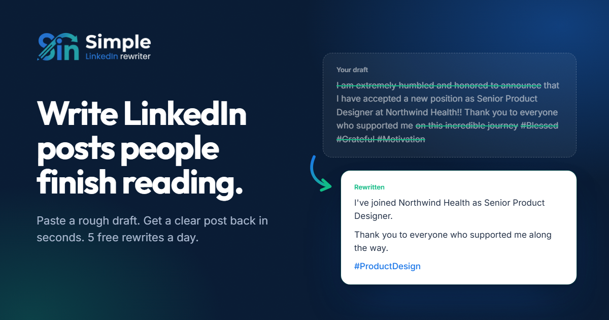

# Simple LinkedIn Rewriter

**Write LinkedIn posts, profiles and messages people actually finish reading.**

You know what you want to say. Finding the right words takes time. Paste your rough draft, choose a tone, and get a clear, professional version back in seconds that still sounds like you.

👉 **Try it free:** https://simplelinkedinrewriter.vercel.app

## What you can do with it

### ✍️ Rewrite LinkedIn posts
Turn rough notes or a messy draft into a post that's easy to read and invites comments. Your point comes first, the filler and clichés go, and short paragraphs keep people reading to the end.

### 👤 Improve your profile
Paste your headline, About section, or a job from your experience. You get a sharper headline, an About section that tells your story, and achievement bullet points that show your impact.

### 💬 Write better messages
Connection requests that get accepted, replies to recruiters, polite follow-ups, and messages to potential clients that are short, personal, and end with a clear next step.

### 🎚️ Choose your tone
**Natural**, **Confident & friendly**, **Formal**, **Concise** or **Persuasive**. Switch between them and compare before you post.

## See the difference

**Before:**
> I learned a lot from working on this project. It was difficult but we managed to finish it and I am happy with the result.

**After:**
> Every challenging project teaches you something new.
>
> This experience pushed me to solve problems, collaborate with my team, and keep moving forward when things got difficult.
>
> I'm proud of what we achieved and grateful for the lessons learned along the way.

Better structure, tone and readability, with your message kept intact.

## Why people use it

- **It sounds like you.** Your meaning, facts and voice stay. Nothing about you is made up: no invented numbers, job titles, results or events.
- **It's fast.** Paste, pick a tone, done. No prompts to write and no settings to learn.
- **No sign-up needed.** Start rewriting right away. An account is optional and only needed if you want your plan to follow you across devices.
- **Your words stay yours.** Drafts aren't stored, and we never ask for your LinkedIn login or post on your behalf.

## Plans

| | Free | Pro | Invited |
|---|---|---|---|
| **Price** | €0 | €6 / month · *coming soon* | €0 with an invite code |
| **Rewrites** | 5 a day | Unlimited | Unlimited |
| **Posts, profile and messages** | ✅ | ✅ | ✅ |
| **All 5 tones** | ✅ | ✅ | ✅ |
| **Voice profile trained on your past posts** | | Coming soon | As Pro features launch |
| **Rewrite history and saved drafts** | | Coming soon | As Pro features launch |

Want to know when Pro launches? [Join the waitlist](mailto:xiarui091@gmail.com?subject=Pro%20waitlist).

## What early users say

> "I often know what I want to say on LinkedIn, but finding the right words takes time. This tool helps me turn rough thoughts into clear, professional posts in seconds."
> **Adrian Sanchez**, Marketing Manager

> "No complicated settings or unnecessary steps. I enter my text, rewrite it, and get a more polished version that still sounds like me."
> **Mike Haccke**, Software Engineer

> "Whether I'm refining a LinkedIn post or improving a professional message, this tool gives me a useful starting point and saves me time."
> **Simon Zieger**, Business Development Manager

> "I like that I can focus on the message instead of worrying about how to phrase every sentence. It makes polishing my writing feel effortless."
> **Marvin Luelmo**, Sales Consultant

> "Ich bin sehr zufrieden mit Simple LinkedIn Rewriter! Das Tool hilft dabei, LinkedIn-Beiträge schnell und unkompliziert zu verbessern und professioneller zu formulieren, ohne die ursprüngliche Aussage zu verändern. Die Benutzeroberfläche ist übersichtlich und intuitiv, sodass die Nutzung besonders einfach und effizient ist. Absolut empfehlenswert für alle, die ihre LinkedIn-Beiträge optimieren möchten!"
> **Markus T.**

> "Simple LinkedIn Rewriter ist ein wirklich praktisches und benutzerfreundliches Tool! Es hilft dabei, LinkedIn-Beiträge schnell zu verbessern und professioneller zu gestalten. Besonders gut gefällt mir, wie einfach die Bedienung ist und wie natürlich die überarbeiteten Texte klingen. Sehr empfehlenswert für alle, die ihre LinkedIn-Präsenz verbessern möchten!"
> **Saskja T.**

## Coming next

- **Pro plan** with unlimited rewrites
- **Voice profile** that learns your style from your past posts
- **Rewrite history**, so you can come back to earlier versions

## Contact

Questions, feedback or partnership ideas: **xiarui091@gmail.com**

[Privacy policy](https://simplelinkedinrewriter.vercel.app/privacy.html) · [Terms of use](https://simplelinkedinrewriter.vercel.app/terms.html)

---

Simple LinkedIn Rewriter is an independent product and is not affiliated with LinkedIn.
